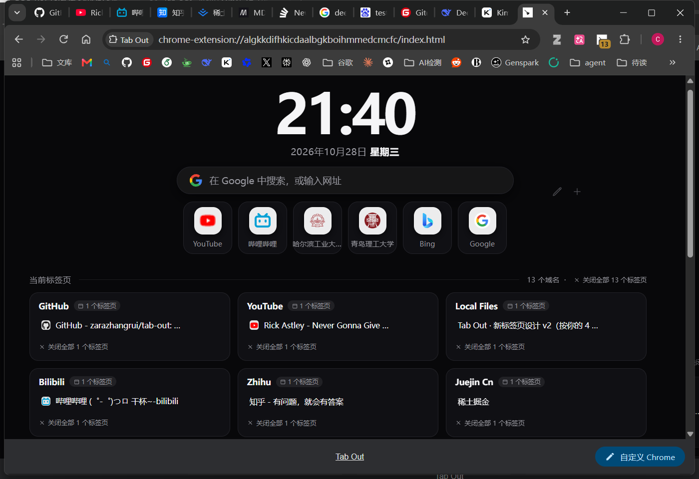
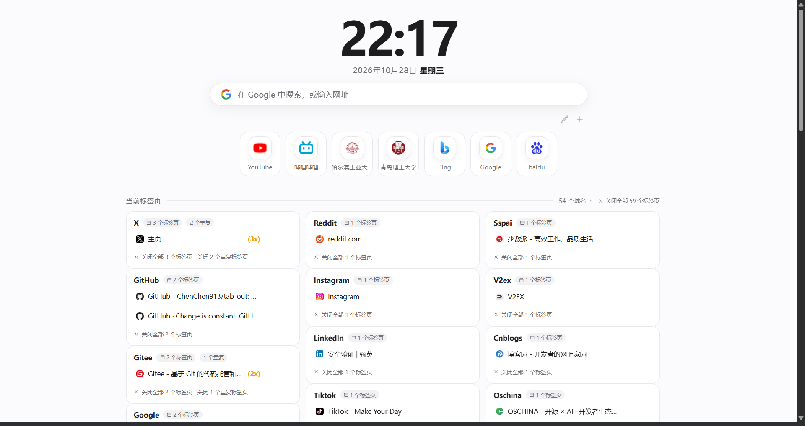
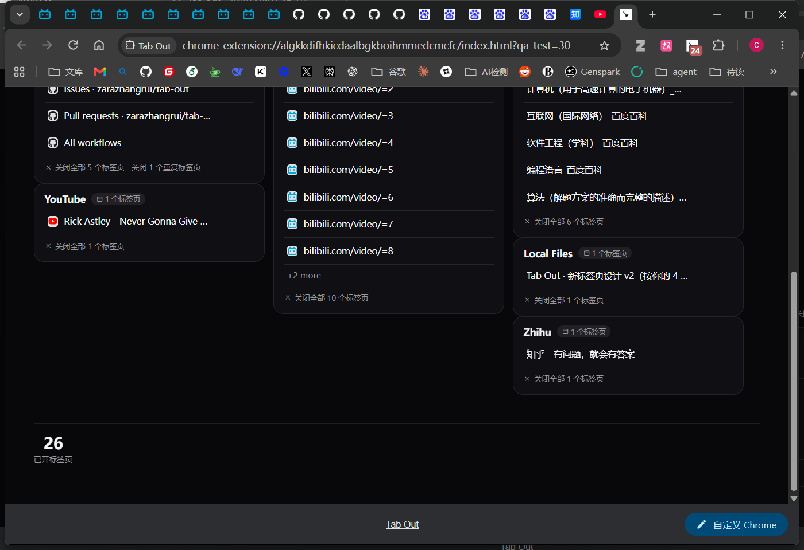
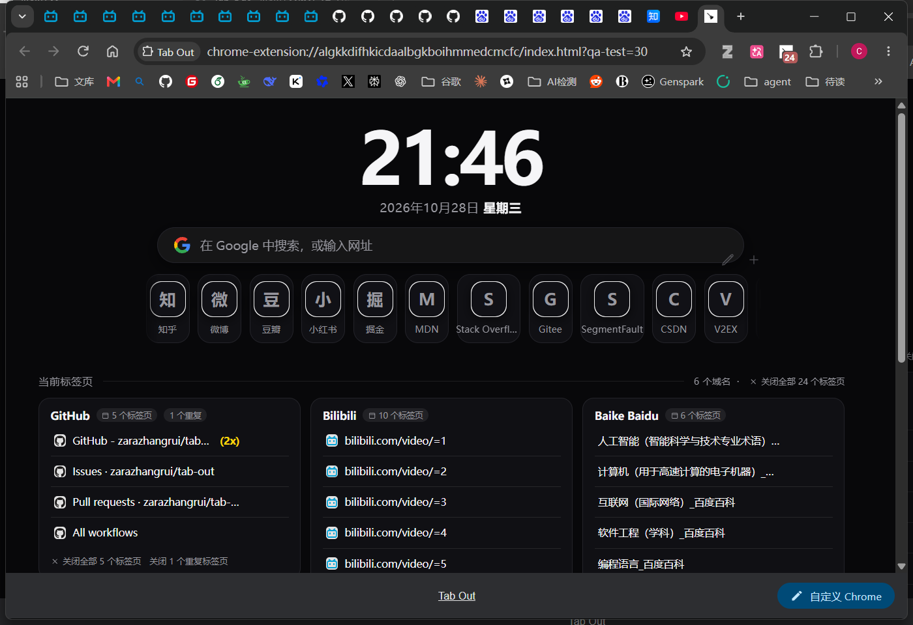
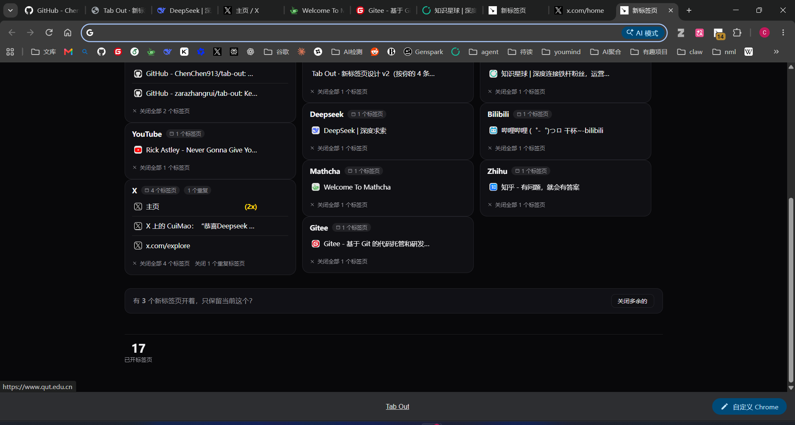

# Tab Out · 个人改造版

> **本项目基于开源项目 [zarazhangrui/tab-out](https://github.com/zarazhangrui/tab-out) 改造，不是原创作品。**
>
> - 原作者：**Zara**（X / Twitter：[@zarazhangrui](https://x.com/zarazhangrui)）
> - 原项目：https://github.com/zarazhangrui/tab-out
> - 许可证：MIT（见 [LICENSE](LICENSE)）
>
> 本仓库为原项目的 **fork**，仅用于个人学习和日常使用，保留原作者版权声明与 MIT 许可证，未用于任何商业用途。感谢原作者的优秀作品。

## 这个版本改了什么

在原项目基础上做了个人使用向的 UI 重构与功能增强：

- **全新新标签页界面**：大号时钟 + 年月日/星期 + Google 搜索框，顶部只保留必要信息
- **常用网站管理**：搜索框下方 ✎ 编辑按钮进入编辑模式，可**改名、改网址、删除、添加**
- **图标本地缓存**：常用网站图标内置 base64（YouTube / B站 / 哈工大 / 青岛理工 / 研招网 / Bing / Google），新网站首次加载后缓存到本地，之后不再联网加载
- **自动昼夜主题**：6:00–20:00 白天模式，20:00–6:00 黑夜模式，自动切换
- **标签页分组卡片**：按域名自动分组，瀑布流布局；支持整组关闭、单标签关闭 / 稍后查看
- **重复标签页检测**：同一 URL 开多个时提示并可一键清理
- **常用网站单行横向滚动**：加很多常用网站也不会把标签页区域挤下去
- **中文本地化**：界面文案以中文为主

## 更新记录

- **v1.1.1**
  - 修复：X / Twitter 主页（x.com/home）之前被归入「常用主页」分组、看起来像"没显示"的问题，现在 X 会单独显示为一张卡片
  - 新增：标签页行会显示对应网站的图标（内置常用站点 + 首次加载后本地缓存）
- **v1.1.0** 首个改造版本（时钟/搜索/昼夜主题/快捷访问编辑/标签分组）

## 实机效果

| 黑夜模式 | 白天模式 |
| --- | --- |
|  |  |

| 同类标签页分组 | 大量常用网站 |
| --- | --- |
|  |  |

带网站图标与 X 卡片的效果：



## 安装方法（Chrome / Edge）

本项目未上架扩展商店，使用「加载已解压的扩展程序」安装：

1. 下载或 clone 本仓库到本地
2. 打开 Chrome，地址栏进入 `chrome://extensions`
3. 打开右上角的 **开发者模式**
4. 点击 **加载已解压的扩展程序**，选择本仓库的 `extension` 文件夹
5. 打开新标签页（Ctrl+T）即可看到效果

> 更新扩展代码后，在 `chrome://extensions` 中点击该扩展的刷新按钮即可生效。

## 使用说明

- **时钟 / 日期**：自动显示，无需设置
- **搜索框**：输入关键词回车 → Google 搜索；输入网址回车 → 直接打开
- **常用网站**
  - 点击图标打开网站
  - 点搜索框下方 **✎** 进入编辑模式：每个图标右上角出现 **✎（修改名称/网址）** 和 **×（删除）**
  - 点 **+** 添加新的常用网站
- **标签页卡片**
  - 点击标签标题 → 切到该标签页
  - 悬停标签行 → 右侧出现「稍后查看 / 关闭」按钮
  - 卡片底部「关闭全部 N 个标签页」→ 整组关闭
  - 重复 URL 会显示「N 个重复」标记，可一键清理
- **主题**：按时间自动切换，白天/黑夜无需手动设置

## 项目结构

```
tab-out/
├── extension/              # Chrome 扩展本体（加载此目录）
│   ├── manifest.json       # Manifest V3 配置
│   ├── index.html          # 新标签页结构
│   ├── style.css           # 原项目基础样式
│   ├── style-v4.css        # 本改造版样式（主题/布局）
│   ├── app.js              # 标签页分组、常用网站、稍后查看等逻辑
│   ├── hero.js             # 时钟/日期/自动昼夜/搜索框
│   ├── favicons-bundled.js # 内置常用网站图标（base64）
│   ├── background.js       # 工具栏徽标
│   └── icons/
├── screenshots/            # 效果截图
├── LICENSE                 # MIT（原作者版权）
├── README.md
└── AGENTS.md
```

## 致谢

- 原项目：[zarazhangrui/tab-out](https://github.com/zarazhangrui/tab-out) · 作者 [Zara](https://x.com/zarazhangrui)
- 本项目仅在其基础上做个人化改造，所有原始设计版权归原作者所有

## License

MIT，详见 [LICENSE](LICENSE)。原项目版权声明予以保留。
